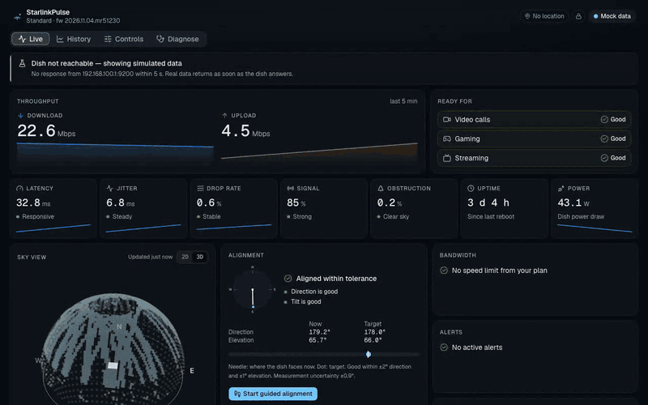

# StarlinkPulse

Desktop app for keeping an eye on a Starlink dish. Runs in the menu bar / system tray on macOS, Windows and Linux and talks to the dish over its local API, so no account or internet connection is needed.



More screenshots in [docs/screenshots](docs/screenshots) (taken in demo mode).

## What it does

- Live speed, latency, packet loss, obstruction and power draw
- 48 hours of history stored locally (SQLite), with charts and an outage log
- Obstruction map (flat or 3D) and an alignment helper for non-motorized dishes
- Diagnose tab: built-in rules that look at the last 24 h and tell you what's likely wrong. Works offline.
- Optional AI explanation of the diagnosis, using your own Claude API key or a local model (Ollama, LM Studio, llama.cpp). Off by default.
- Notifications for outages, overheating, reboots, data cap, etc.
- Reboot / stow / snow melt, if your dish supports them. Read-only mode is on by default.
- CSV export
- English and Italian

There's also a demo mode with fake data if you want to try it without a dish.

## Supported dishes

The app doesn't ship any SpaceX `.proto` files. It reads the schema from the dish at startup (gRPC reflection), so it follows whatever firmware you're on. Should work with Gen 1, Standard, Standard Actuated, Mini, High Performance and Flat. Features the dish doesn't report are just hidden. Details in [docs/compatibility.md](docs/compatibility.md).

Recent firmware blocks most config changes over the local network. When that happens the app tells you and hides the control.

## Install

Grab the latest build from [Releases](../../releases).

macOS builds aren't notarized yet. If macOS says the app is damaged:

```sh
xattr -cr /Applications/StarlinkPulse.app
```

On Windows, SmartScreen may complain about the unsigned installer: More info → Run anyway.

On Linux, use the `.AppImage` or `.deb`. The tray icon on GNOME needs the AppIndicator extension. Saving a Claude API key needs gnome-keyring or KWallet; if you don't have one, start the app with `STARLINKPULSE_KEYRING_FILE=1` to store the key in a file (mode 0600, plain text).

## Network

The dish is at `192.168.100.1:9200`. With the Starlink router it just works. With your own router or in bypass mode you may need a static route:

```sh
# macOS
sudo route -n add 192.168.100.1/32 192.168.1.1
# Linux
sudo ip route add 192.168.100.1/32 via 192.168.1.1
# Windows (admin)
route add 192.168.100.1 mask 255.255.255.255 192.168.1.1
```

Replace `192.168.1.1` with your router's IP. Wi-Fi client info needs a Starlink router (`192.168.1.1:9000`). Both addresses can be changed in Settings.

## Privacy

Nothing leaves your computer unless you turn on AI explanations and click the button. Before sending, the app shows you the exact JSON and where it's going. It only sends aggregated stats (latency, loss, outages, obstruction, firmware version). Never serial numbers, MAC/IP addresses or location.

## Building

Needs Node 20+, Rust 1.85+ and the [Tauri v2 prerequisites](https://v2.tauri.app/start/prerequisites/).

```sh
npm ci
npm run tauri dev
npm run tauri build
```

`npm run dev` runs just the UI in a browser with a mock backend. Tests: `npm test` and `cargo test` in `src-tauri/`. See [CONTRIBUTING.md](CONTRIBUTING.md).

## Disclaimer

Not affiliated with SpaceX or Starlink. Data usage numbers are estimates. Use the dish controls at your own risk.

## License

MIT
