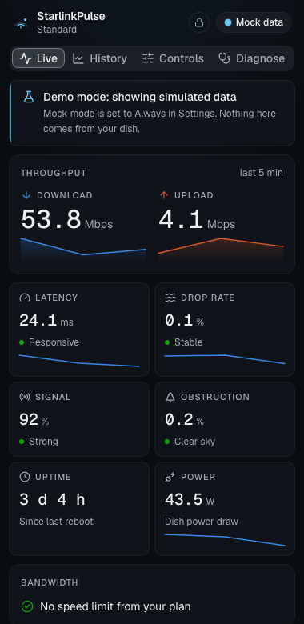
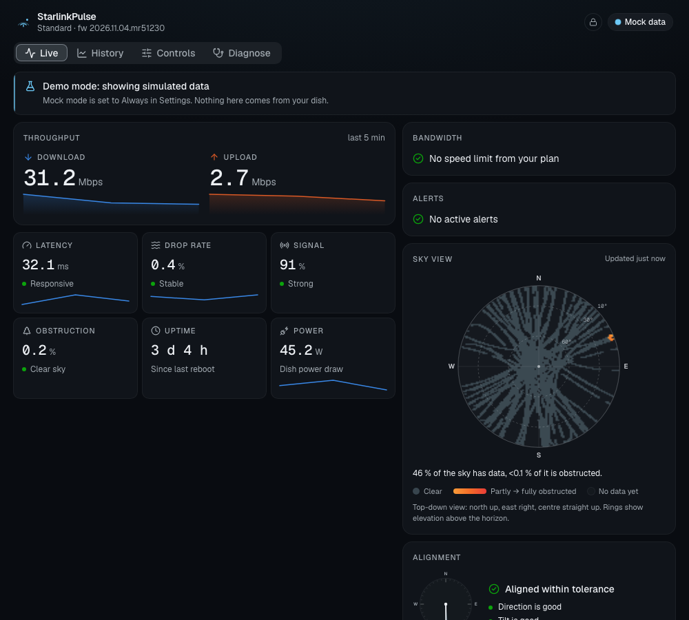
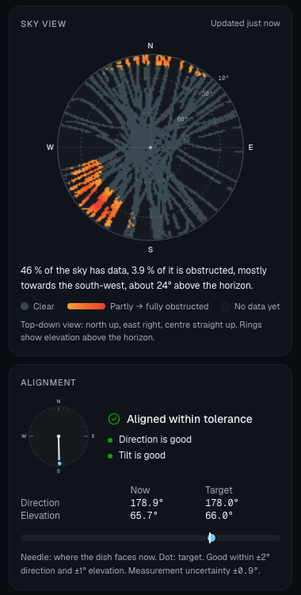
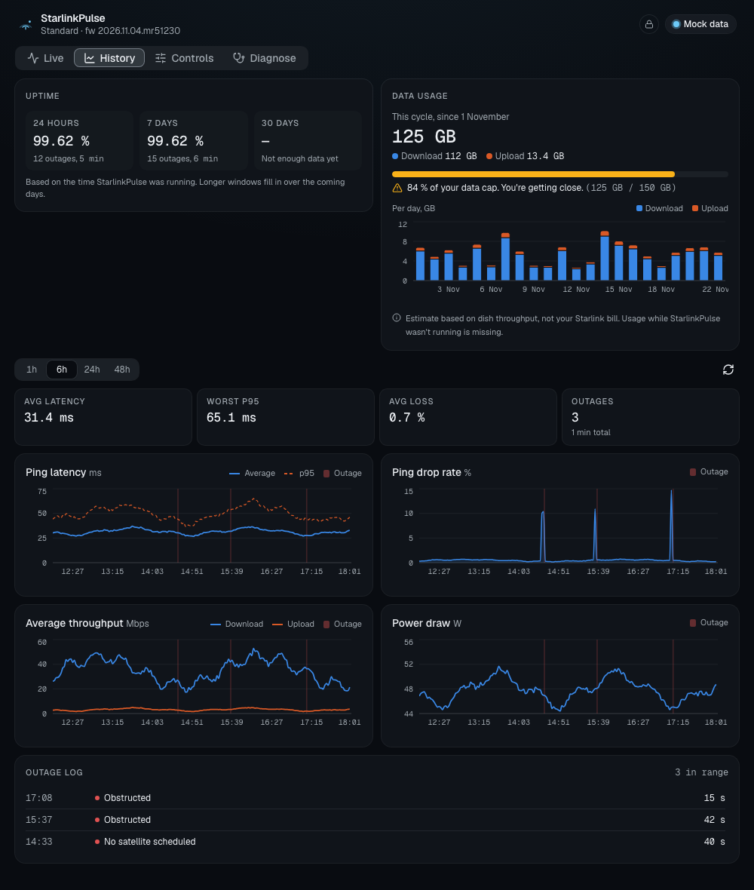
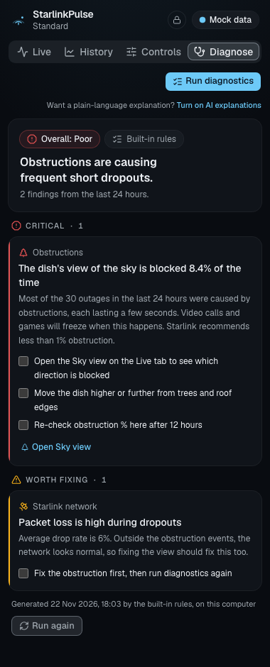

# StarlinkPulse

StarlinkPulse is a small desktop app for macOS, Windows and Linux. It monitors your Starlink dish through the dish's local API. It lives in the menu bar / system tray and shows live speed, latency, packet loss, obstructions and alerts. It keeps 48 hours of history on your computer, and its built-in **Diagnose** tab explains what is slowing your connection down. That works offline, for free and without an account. If you want, an AI model can add a plain-language explanation: Claude with your own API key, or a local model running on your own computer. It works with every dish model it can reach and only shows features your dish and firmware support.

| Tray popup | Desktop window |
|---|---|
|  |  |
|  |  |
|  | |

<sub>Screenshots taken in demo mode with simulated data.</sub>

## Features

- **Live**: download/upload, latency, packet loss, signal quality, obstruction %, uptime and power draw (if your dish reports it), with 5-minute sparklines.
- **Alerts in plain words**: thermal throttling, motors, water detected, and more. Plan speed limits (`POLICY_LIMIT`) are explained as "speed limited by plan".
- **Sky view**: a polar obstruction map with a text summary, e.g. "mostly towards the south-west, about 25° above the horizon".
- **Alignment helper** for dishes without motors: "Rotate 11° clockwise, seen from above", "Tilt 2° up", with a tolerance indicator.
- **History**: 1 h / 6 h / 24 h / 48 h charts for latency (average and p95), packet loss, throughput and power, with outage markers and an outage log.
- **Uptime** over 24 hours / 7 days / 30 days and **estimated data usage** per billing cycle, with an optional data cap.
- **Desktop notifications** for outages, new obstructions, overheating, plan speed limits, reboots, software updates and the data cap, each switchable, plus quiet hours.
- **Diagnose**: built-in rules turn the last 24 hours into a report that separates obstructions, alignment, the Starlink network (including plan limits), outages, Wi-Fi, overheating and hardware, each with a checklist. It runs offline, needs no key and costs nothing.
- **Explain with AI** (optional, off by default): have Claude (your own API key) or a local model (Ollama, LM Studio, llama.cpp) explain and prioritize the findings.
- **Dish controls** (reboot, stow/unstow, snow melt), shown only when supported. They are protected by **read-only mode**, which is on by default, and every action asks for confirmation.
- **CSV export** of the per-minute history.
- **Demo mode** with simulated dish models and fault states, so you can try the app without a dish.

## Supported dishes

StarlinkPulse does not ship any SpaceX `.proto` files. When it connects, it downloads the message schema from your dish (gRPC server reflection), so it follows your firmware.

| Model | Monitoring | Stow / unstow | Alignment helper |
|---|---|---|---|
| Standard Actuated, Gen 1 (round) | yes | if allowed by firmware | – (dish steers itself) |
| Standard (rectangular, Rev 3/4) | yes | – | yes |
| Mini | yes | – | yes |
| High Performance, Flat High Performance | yes | – | yes |

Notes:

- Fields differ between models and firmware versions. Anything the dish doesn't report is shown as "—" with an explanation, never as an error. See [docs/compatibility.md](docs/compatibility.md).
- **Write commands may be blocked by firmware.** Recent firmware answers `PermissionDenied` to configuration changes over the local network, because they need the Starlink app. StarlinkPulse then says the change is blocked and hides that control for that firmware. It never retries in a loop.
- Wi-Fi features need a Starlink router (`192.168.1.1:9000`). They are skipped with third-party routers or in bypass mode.

## Install

Download the latest build for your system from [Releases](../../releases).

### macOS

Open the `.dmg` and drag **StarlinkPulse** to Applications. Until the app is signed and notarized, Gatekeeper may say it "is damaged" or "can't be opened". If you trust the download, remove the quarantine flag once:

```sh
xattr -cr /Applications/StarlinkPulse.app
```

### Windows

Run the `.msi` or `.exe` installer. Unsigned builds can trigger **Microsoft Defender SmartScreen**: choose **More info → Run anyway**.

### Linux

Use the `.AppImage` or the `.deb` package.

```sh
chmod +x StarlinkPulse_*.AppImage
./StarlinkPulse_*.AppImage
```

- **Keychain**: a Claude API key is stored with the Secret Service API. Install and unlock **gnome-keyring** (GNOME and most desktops) or **KWallet** (KDE). Without one, a Claude key can't be saved. Diagnose, local models and the rest of the app work normally.
- **No Secret Service?** You can opt in to a file instead. Start the app with `STARLINKPULSE_KEYRING_FILE=1`, for example `STARLINKPULSE_KEYRING_FILE=1 ./StarlinkPulse_*.AppImage`. The key is then saved in the app data folder (`~/.local/share/io.github.starlinkpulse/anthropic-api-key`) with `0600` permissions. The fallback is used only when the Secret Service is unavailable.
  > **Less secure:** the file is plain text, protected only by file permissions. Anyone with access to your user account or your backups can read it. Prefer a keyring when you can.
- **Tray icon on GNOME** requires the AppIndicator extension (for example `gnome-shell-extension-appindicator`).

## Network setup

The app talks to the dish at **`192.168.100.1:9200`** (gRPC, local network only, no internet needed).

- **With the Starlink router**: nothing to do.
- **With a third-party router or Starlink bypass mode**: your computer may not reach `192.168.100.1`. Add a static route through your router's IP (replace `192.168.1.1` with your router's address):

  ```sh
  # macOS
  sudo route -n add 192.168.100.1/32 192.168.1.1

  # Linux
  sudo ip route add 192.168.100.1/32 via 192.168.1.1

  # Windows (Administrator prompt; add -p to keep it after reboot)
  route add 192.168.100.1 mask 255.255.255.255 192.168.1.1
  ```

  Many routers can also add this route for the whole network. Look for "static routes" in your router's settings.

Both addresses can be changed in **Controls → Settings**.

## Diagnose, optional AI, and privacy

**Diagnose works for everyone.** The Diagnose tab runs built-in rules over the last 24 hours on your computer: obstruction %, alignment offset, plan speed limits and busy hours, outage causes, Wi-Fi signal, overheating and frequent reboots. Nothing leaves your computer, no account or key is needed, and it's free. It needs at least an hour of history.

**AI explanations are an optional extra**, off by default. Turn them on in **Controls → Settings → AI explanations** and choose a provider:

| Provider | Where your data goes | Cost | Setup |
|---|---|---|---|
| **Off** (default) | Nowhere | Free | – |
| **Local model** | To the model server you configure. With the default `http://localhost:11434`, nothing leaves your computer. | Free | Install [Ollama](https://ollama.com) (`ollama pull <model>`) or an OpenAI-compatible server such as LM Studio or llama.cpp, then pick the model in Settings |
| **Claude** | To Anthropic's API, using your own key | Billed to your Anthropic account | Add your API key in **Controls → Anthropic API key** |

- **You see exactly what is sent.** Clicking **Explain with AI** first shows the full JSON payload and names the destination (Anthropic, or the URL of your local server). Nothing is sent until you click **Send and analyze**. If a "local" URL points to another machine, the app warns you that data will leave this computer.
- **What is sent**: aggregated numbers from the last 24 hours plus the built-in rule findings. That covers latency (average and p95), packet loss, obstruction %, outage counts by cause, worst hours, throttled minutes, alignment offsets, the weakest Wi-Fi signal, and hardware/firmware version strings. **Never** device IDs, serial numbers, MAC addresses, client names, IP addresses or GPS location.
- **Claude**: the model is `claude-opus-5-5` by default. You can pick `claude-sonnet-5-5` (balanced), `claude-haiku-5-5` (fastest, cheapest) or a custom model ID. The key is stored in your system keychain, never shown again and never logged. Each explanation is a single API request (retried once if Anthropic is briefly overloaded).
- **Local models**: no key needed. Results depend on the model you choose. Larger models give better explanations but can take a minute or more on modest hardware.
- **Nothing runs automatically**: AI explanations run only when you click the button.

## Demo mode

If the dish can't be reached, StarlinkPulse switches to simulated data and says so clearly ("Mock data" badge and a banner). In **Controls → Settings → Mock mode** you can set it to **Always** (demo) or **Never**. You can also choose a profile: Mini, Standard, Standard Actuated, Obstructed sky, Throttled plan or Offline dish. Dish controls in demo mode never touch a real dish.

## Build from source

Prerequisites:

- [Node.js](https://nodejs.org) 20 or newer, and npm
- [Rust](https://rustup.rs) 1.85 or newer (edition 2024)
- The Tauri v2 system dependencies for your OS: <https://v2.tauri.app/start/prerequisites/>. On macOS that means the Xcode Command Line Tools. On Linux it means WebKitGTK, `libayatana-appindicator3-dev`, `librsvg2-dev` and `libdbus-1-dev`.

```sh
npm ci
npm run tauri dev     # run the desktop app with hot reload
npm run tauri build   # build installers into src-tauri/target/release/bundle
```

UI-only work without Rust or a dish: `npm run dev` opens the interface in a browser with an in-browser mock backend. See [CONTRIBUTING.md](CONTRIBUTING.md).

Tests: `npm test` (frontend) and `cargo test` in `src-tauri/` (backend).

## Project structure

```
src/                    React + TypeScript UI
  components/           Live, History, Controls, Diagnose, Sky views
  hooks/, state/        Data hooks and live state (Tauri events)
  lib/api.ts            Typed wrappers for every backend command and event
  lib/mock/             In-browser mock backend (dev only)
  types/models.ts       Shared types (mirror of src-tauri/src/models.rs)
src-tauri/              Rust backend (Tauri v2)
  src/dish/             gRPC client via server reflection, mock client
  src/ai/               Optional AI explanations (Claude API, Ollama / OpenAI-compatible)
  src/storage.rs        SQLite history (48 h, daily aggregates)
  src/tray.rs           Menu bar / tray
docs/api.md             Command and event contract between UI and backend
docs/compatibility.md   Differences between dish models and firmware
```

## Disclaimer

StarlinkPulse is an independent open-source project. It is **not affiliated with, endorsed by or supported by SpaceX or Starlink**. "Starlink" and "SpaceX" are trademarks of Space Exploration Technologies Corp. "Claude" and "Anthropic" are trademarks of Anthropic, PBC. Data usage figures are estimates, not billing data. Use dish controls at your own risk.

## Contributing

Bug reports, dish compatibility reports and pull requests are welcome. Please read [CONTRIBUTING.md](CONTRIBUTING.md) first.

## License

[MIT](LICENSE)
